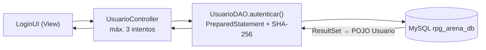

# Arena Segura

Sistema interactivo tipo juego RPG por consola, desarrollado en **Java probado con JDK 21** con arquitectura **MVC + DAO**, persistencia en **MySQL/DBeaver mediante JDBC** y buenas prácticas de seguridad contra **inyección SQL**.

---

## 1. Descripción general

**Arena Segura** permite a los usuarios autenticarse, consultar un bestiario de monstruos, combatir en una arena y competir en un ranking de victorias. El proyecto tiene un doble propósito: funcionar como aplicación completa y servir de **demostración didáctica de seguridad** (vulnerabilidad de inyección SQL frente a su mitigación).

| Aspecto | Implementación |
|:--|:--|
| Arquitectura | MVC + DAO: `view`, `controller` y `model` (que contiene entidades y acceso a datos) |
| Persistencia | JDBC con `mysql-connector-j`; conexiones gestionadas por `DriverManager` (`ConexionDB`) |
| Autenticación | Login con roles `JUGADOR` / `ADMIN`; máximo de 3 intentos fallidos antes de bloquear la sesión |
| Contraseñas | Almacenadas como hash SHA-256 (`MessageDigest`) |
| Seguridad SQL | Capa de datos con `PreparedStatement` y `try-with-resources` en el 100 % de las consultas |
| Reglas de negocio | Solo el ADMIN gestiona monstruos y usuarios; borrado seguro (no se elimina un registro con victorias asociadas); **solo se guarda la victoria si el jugador gana** |
| Motor de combate | Motor RPG (`Arena`, `Guerrero`, `Mago`, `Enemigo`) integrado en `com.miapp.model.rpg` |

> **Nota sobre el pool de conexiones.** El proyecto abre una conexión por operación con `DriverManager` (suficiente para una aplicación de consola y requisito didáctico del curso). No utiliza HikariCP; incorporarlo es una mejora posible para entornos con alta concurrencia.

### Funcionalidades

- **Login y registro.** El auto-registro público siempre crea usuarios con rol `JUGADOR`.
- **Bestiario.** Consulta, filtro por vida mínima y CRUD de monstruos (solo ADMIN).
- **Combate.** El jugador elige clase (Guerrero o Mago) y un monstruo del bestiario.
- **Ranking.** Clasificación general por victorias (`JOIN` + `GROUP BY`) e historial personal.
- **Gestión de usuarios (ADMIN).** Crear, cambiar nombre, clave y rol, y eliminar usuarios, con protecciones (no autoeliminarse, no eliminar al último ADMIN).

---

## 2. Configuración y ejecución

### 2.1 Requisitos previos

- **JDK 17 o superior** (probado con JDK 21).
- **MySQL 8.x** o **MariaDB 10.x** en ejecución (puerto 3306 por defecto).
- **Apache Maven 3.8+** (o el Maven integrado de IntelliJ IDEA).
- Opcional: **DBeaver** como cliente de base de datos.

### 2.2 Crear la base de datos `rpg_arena_db`

El archivo `schema.sql` crea la base de datos, las tablas (`jugadores`, `monstruos`, `victorias`) con sus claves primarias, foráneas e índices, y carga datos de prueba.

**Desde la línea de comandos:**

```bash
mysql -u root -p < schema.sql
```

**Desde DBeaver:**

1. *Database → New Database Connection → MySQL* (o MariaDB) con host `localhost`, puerto `3306`, su usuario y contraseña. Si aparece `Public Key Retrieval is not allowed`, agregue en *Driver properties* `allowPublicKeyRetrieval=true` y `useSSL=false`.
2. Abra `schema.sql` en el editor SQL y ejecútelo completo con **Alt + X** (*Execute Script*).
3. Haga clic derecho sobre la conexión → *Refresh* y verifique las tablas en `rpg_arena_db`.

> ⚠️ `schema.sql` elimina y recrea las tablas (`DROP TABLE`). Úselo solo para inicializar.

**Modelo de datos**

| Tabla | Campos principales |
|:--|:--|
| `jugadores` | `id` (PK, AI), `usuario` (único), `clave` (hash SHA-256), `rol` (`JUGADOR` / `ADMIN`) |
| `monstruos` | `id` (PK, AI), `nombre` (único), `vida`, `ataque` |
| `victorias` | `id` (PK, AI), `jugador_id` (FK), `monstruo_id` (FK), `fecha` (`DEFAULT CURRENT_TIMESTAMP`) |

### 2.3 Configurar la conexión

La aplicación lee sus parámetros del archivo `config.txt`, ubicado en la raíz del proyecto (el directorio desde el que se ejecuta). Copie la plantilla y ajuste las credenciales:

```bash
cp config.example.txt config.txt
```

```properties
db.url=jdbc:mysql://localhost:3306/rpg_arena_db?useSSL=false&allowPublicKeyRetrieval=true&serverTimezone=UTC
db.user=root
db.password=SU_CLAVE
```

`config.txt` figura en `.gitignore` para no publicar credenciales. Si falta o está incompleto, la aplicación muestra un mensaje explicativo indicando cómo corregirlo.

### 2.4 Compilar y ejecutar

**Con Maven (terminal, desde la raíz del proyecto):**

```bash
mvn compile exec:java
```

**Con IntelliJ IDEA:**

1. *File → Open* y seleccione la carpeta del proyecto (la que contiene `pom.xml`).
2. *File → Project Structure → Project → SDK*: elija JDK 21.
3. Abra `src/main/java/Main.java` y ejecute `main`. En *Run → Edit Configurations → Working directory* debe estar la carpeta donde reside `config.txt`.

**Usuarios de prueba**

| Usuario | Contraseña | Rol |
|:--|:--|:--|
| `admin` | `admin123` | ADMIN |
| `arturo` | `player123` | JUGADOR |
| `merlin` | `player123` | JUGADOR |

---

## 3. Inyección SQL: demostración y defensa

### 3.1 La vulnerabilidad (`LoginInseguroDemo.java`)

La clase `demo.LoginInseguroDemo` construye la consulta de autenticación **concatenando** los datos del usuario con un `Statement`:

```java
String sql = "SELECT id, usuario, clave, rol FROM jugadores WHERE usuario = '"
        + usuario + "' AND clave = '" + clave + "'";
var stmt = conn.createStatement();
var rs = stmt.executeQuery(sql);
```

El motor SQL recibe un único texto en el que **no distingue entre la estructura de la consulta y los datos** ingresados. Un atacante puede introducir sintaxis SQL como dato.

**Payload de la demostración:** `admin' OR 1=1 -- ` (con un espacio final) y cualquier contraseña.

```sql
SELECT id, usuario, clave, rol FROM jugadores
WHERE usuario = 'admin' OR 1=1 -- ' AND clave = '...'
```

1. La comilla simple `'` cierra prematuramente el literal de `usuario`.
2. `OR 1=1` convierte la condición en una **tautología**: es verdadera para todas las filas.
3. `-- ` (guion doble seguido de espacio, requisito de MySQL/MariaDB) **comenta el resto** de la consulta, eliminando la validación de la clave.

Resultado: el sistema autentica al primer usuario de la tabla (el administrador) **sin conocer su contraseña**.

El payload clásico `' OR '1'='1` funciona con el mismo principio. Si el valor se inyecta en ambos campos, la consulta resultante `WHERE usuario = '' OR '1'='1' AND clave = '' OR '1'='1'` también resulta siempre verdadera, sin necesidad de comentarios.

Puede ejecutarse desde el menú principal, opción **4. Demo de Inyección SQL**.

### 3.2 La mitigación (`UsuarioDAO.autenticar`)

La capa de datos usa exclusivamente `PreparedStatement` con parámetros:

```java
String sql = "SELECT id, usuario, clave, rol FROM jugadores WHERE usuario = ? AND clave = ?";
try (Connection conn = ConexionDB.getConnection();
     PreparedStatement ps = conn.prepareStatement(sql)) {
    ps.setString(1, usuario);
    ps.setString(2, PasswordHasher.hash(clave));
    try (ResultSet rs = ps.executeQuery()) { /* mapeo a POJO Usuario */ }
}
```

**Por qué neutraliza el ataque:**

- La **estructura SQL** (con los marcadores `?`) y los **datos** viajan por separado. Los valores se tratan siempre como literales, nunca como sintaxis.
- El payload `admin' OR 1=1 -- ` se compara como un nombre de usuario literal; como no existe, la consulta devuelve cero filas y el acceso se deniega.
- Las comillas y los caracteres especiales se escapan automáticamente.

**Defensas complementarias:**

| Medida | Descripción |
|:--|:--|
| Hash SHA-256 | La base guarda solo el hash de la clave. `autenticar` compara únicamente contra el hash, por lo que conocerlo no permite iniciar sesión. |
| Límite de intentos | Al tercer intento fallido, la sesión se bloquea (`UsuarioController`). |
| Principio de mínimo privilegio | Solo el ADMIN gestiona monstruos y usuarios; el auto-registro nunca crea administradores. |
| Cierre de recursos | `try-with-resources` en todas las consultas (`Connection`, `PreparedStatement`, `ResultSet`). |
| Capa aislada | `java.sql` se usa solo en `model`; la vista y los controladores reciben POJOs y listas. |

> El hash protege la clave **en reposo**, pero la inyección ataca la **estructura** de la consulta (por ejemplo, el campo `usuario`). Por eso `PreparedStatement` sigue siendo obligatorio aunque se use hashing. Una mejora recomendada es añadir *salt* o usar BCrypt.

### 3.3 Comparativa y rendimiento

La opción **5** del menú (*Demo de rendimiento*) mide 1000 inserciones con `Statement`, `PreparedStatement` y `PreparedStatement` en lote. Los resultados completos se documentan en `INFORME.md`.

---

## 4. Estructura del proyecto y evidencias

### 4.1 Arquitectura de paquetes

```
arena-segura/
├── pom.xml
├── schema.sql
├── config.example.txt
├── config.txt                    (local, ignorado por Git)
├── INFORME.md
└── src/main/java/
    ├── Main.java                 Punto de entrada: solo arranca la View principal
    ├── demo/
    │   └── LoginInseguroDemo.java
    └── com/miapp/
        ├── view/                 LoginUI, UsuarioUI, MonstruoUI, RankingUI,
        │                         MenuPrincipalUI, CombateUI, ConsolaUtil
        ├── controller/           UsuarioController, MonstruoController,
        │                         RankingController, CombateController
        └── model/                Entidades:  Usuario, Monstruo, Victoria
                                  DAO/JDBC:   ConexionDB, UsuarioDAO,
                                              MonstruoDAO, VictoriaDAO
                                  DTO:        RankingDTO, HistorialVictoriaDTO
                                  Utilidad:   PasswordHasher
                                  rpg/        Motor de combate (Arena, Guerrero, Mago, Enemigo)
```

| Paquete | Responsabilidad |
|:--|:--|
| `view` | Captura de datos y presentación por consola. No contiene reglas de negocio ni accede a datos. |
| `controller` | Reglas de negocio: límite de intentos, permisos de ADMIN, borrado seguro, flujo de combate y registro de victorias. |
| `model` | Entidades (POJO), DTO y acceso a datos (DAO con JDBC) en un mismo paquete, según la estructura del curso. Los DAO devuelven POJOs o `List<T>`, nunca `ResultSet`. |
| `demo` | Contiene únicamente `LoginInseguroDemo`, la única clase con `Statement` sin preparar. |

**Flujo del login**



### 4.2 Evidencias de funcionamiento

**Inicio de sesión**

[Demostración Login](https://drive.google.com/file/d/15H2rBirnv0nSnsKi7nJUDkoE4oBJIAFt/view?usp=sharing)

**Demostración de inyección SQL (versión insegura vs. segura)**

[Demostración Inyección SQL](https://drive.google.com/file/d/1BZhP4AfqZyfrxRz0Fp73pIZ2-XefjPd_/view?usp=sharing)

**Flujo de combate (victoria registrada en la base de datos)**

[Demostración Combate](https://drive.google.com/file/d/1bMj53PrzJa9Af1LMGS8kyLGsG_hlMMzS/view?usp=sharing)

**Consulta de ranking general e historial**

[Demostración Ranking](https://drive.google.com/file/d/12OjUq_jcwaCKxlAB52Am2mA2MfLlVdsm/view?usp=sharing)

**Panel de administración (gestión de monstruos y usuarios)**

[Demostración Panel Admin](https://drive.google.com/file/d/1LOcNnj9muf7v1Ev1-_EnkHMA0rxHxcFg/view?usp=sharing)

---

## Autor

Juan Dominguez Navarro - Proyecto individual integrador — *Arena Segura: login, bestiario y ranking con JDBC + MVC*.